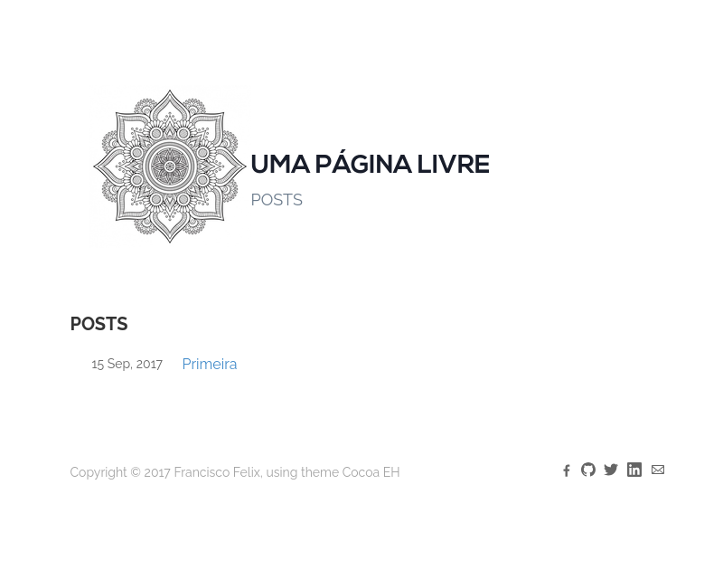
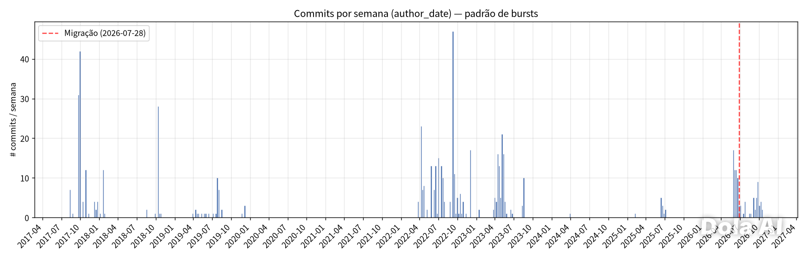

# README

## Sobre o Grupo de heterônimos, precursores, início e desenvolvimento

### Mito e lore da criação deste Grupo

Assim como no mito de criação Desana, ou Wĩrã, "antes o mundo não existia". Porém existiam atividades que iniciei individualmente desde a adolescência. Tenho hoje 54 anos, escrevo estas linhas enquanto faço um apanhado de tudo que já fiz (algo que já indica o grau de obsessão com detalhes fúteis que tenho), mesmo as postagens em redes sociais díspares (fiz muitos perfis em muitas redes, vai dar trabalho). Registro aqui que, movido por uma série de mudanças na vida pessoal e profissional, entendi de encarar meus 50 anos como novos 20 anos (claro delírio, alimentado apenas por, no momento, estar com uma saúde melhor do que a maioria dos contemporâneos e até do que gente com 10-20 anos a menos). Para diferenciar do clássico clichê "lobo da meia idade", digo que isso é uma ideia puramente intelectual e não vaza para a esfera pessoal. Não estou procurando relacionamentos com jovens, estou pretendendo ter a vida cognitiva de alguém de 20 anos. Delírio algo mais leve. Parte desta motivação inclui uma recapitulação dos eventos intelectuais da minha ínfima existência até o momento. Em algum momento vou cansar disso, até lá vou fazer esse apanhado como me aprouver. Na idade em que estou, qual o problema?

#### O Grupo

O Grupo de heterônimos talvez já estivesse sendo gestado há muito tempo, mas veio a existir realmente somente nos últimos anos. Inicialmente, o blogue era anônimo. Posteriormente, tornou-se pseudônimo, sob a pena de "Silver Surfer", embora não existisse identificação ou assinatura em nenhum texto. Haviam duas categorias no menu: postagens (identificadas ordinalmente, a partir da "primeira") e opiniões (duas, "ideologia" e "escravo"). Em 25/02/2018, publiquei a sexta postagem, identificando, pela primeira vez, um novo autor, o qual ainda não assinava, mas foi o primeiro heterônimo _de facto_, João Calangro. A postagem ficou datada de 24, mas foi publicada no dia seguinte. No mesmo dia, criei uma ficha em formato json para Calangro, onde se lia que ele era "um trabalhador braçal da saúde com afinidade por problemas insolúveis e que escreve sobre outras pessoas, geralmente com sua autorização". Somente depois, em 15/11/2018, criei os arquivos json de ssurfer e unown (esse, "um pokemon lendário que às vezes bloga de outra dimensão"). Silver Surfer e Unown nunca vingaram como heterônimos de fato, embora eu tenha chegado a cogitar em fazer do Unown algo como o Alberto Caeiro do grupo (!).

Somente em 2022 passei a realmente identificar o autor de cada texto e criei todos os outros heterônimos. As suas fichas json foram publicadas num curto espaço de tempo, bcalvino em 12/01/2022, hagemanto em 20/05/2022, ffelix em 12/06/2022, aconselheiro em 01/07/2022, jpauper em 16/07/2022, agunn em 05/08/2022. Também passei a atribuir os textos aos heterônimos e o Silver Surfer e suas postagens se tornaram Baldolino Calvino. Os textos posteriores foram assinados por outros autores. Dessa forma, apesar do primeiro heterônimo ter sido o Calangro, os primeiros textos do blogue se mantiveram sob a assinatura de Silver Surfer, que trocou de nome para Calvino. Também rascunhei a história de cada um no arquivo Sobre, que antes apenas dizia "para nada em especial". Na mesma época, criei imagens de cada um dos personagens-autores usando a recém-lançada e muito falada DALL-E 2, hoje incorporada no modelo GPT. Para falar a verdade, a qualidade das imagens era realmente muito ruinzinha, e escolhi as melhores e que me pareceram mais semelhantes aos heterônimos. Foi uma escolha intuitiva e gosto de pensar que os próprios personagens escolheram suas aparências.

Em 20 de outubro de 2017, iniciei o arquivo "Sobre", onde exponho um pouco sobre quem é cada heterônimo e o local onde vivem, Hy-Brasil. Fui escrevendo ao longo do período inteiro, mas principalmente em 2019. Nesse ano, também fiz a versão em inglês, traduzida por mim mesmo. Em 2022, modifiquei a tradução em inglês e criei traduções em francês e mandarim, usando LLM. Depois de 2023, apenas agora em 2026 voltei a modificar essa postagem. De onde saiu Hy-Brasil? Inicialmente, da série [Carnival Row][crow] de 2019, baseada num roteiro postado online em 2005 por Travis Beacham. Na obra, uma investigação de assassinato se passa num mundo de inspiração vitoriana situado na mítica "terra da juventude eterna" irlandesa, _Tir na n'Og_. Na série, o protagonista é Rycroft Philostrate, e isso me deixou pensando até que ponto Beacham pensou num conceito "Holmes encontra a terra das fadas" e, assim, usou o nome do irmão de Sherlock, Mycroft. Depois, interessado no conceito, fui ler o livro de Margaret Elphistone sobre Hy-Brasil.

### A Página Livre

Eu cheguei a ter uma página no extinto Geocities, mas não lembro praticamente nada sobre ela. Ainda tenho a página do [Blogspot][blogspot], cuja [primeira][primeira] postagem foi em 05/06/2007, sobre neuroblastomas. Fiz ao todo 236 postagens lá, a [última][ultima] em 10/02/2018. No início, usei como um [canal][canal] para comunicação com alunos da Faculdade, onde eu ensinava Fisiologia e Farmacologia. Noticiei até o meu [desligamento][desligamento] no blogue. Mudei essa página algumas vezes, e a populei mais com recortes e cópias de conteúdo de notícias médicas. Porém, a atividade mais antiga na internet que ainda existe é a página do Wordpress [Convergência][convergencia], cuja [primeira][primeira-c] postagem foi em 13/06/2006. Interessantemente, precursora da minha postagem sobre [Medicina Quântica][medqub] no blogue que fiz mais tarde e para onde migrei a maior parte do conteúdo do Blogspot. Fiz apenas 39 postagens curtas nesse blogue. A [postagem][postagem] mais recente no Wordpress foi em 27/10/2016. Isso dá cerca de 10 anos de existência para cada página, e 275 postagens, a maioria curtas, muitas apenas transcrições de notícias de outras fontes. Não é algo que se poderia chamar de produção intelectual.

Criei a Página Livre em 16/09/2017, sem conteúdo no commit inicial. No sétimo commit (que ironia) já tinha a primeira postagem, a mesma que ainda está aí. Para ser exato, na sexta postagem já tinha um rascunho incompleto e fiz mudanças na oitava, mas fica a sétima como primeira versão. Por que criei este projeto neste formato? Na época, não pensei demais nisso. Estava aprendendo a usar git, e repositórios como Github (comecei lá em 2015), Bitbucket e Gitlab. Também estava brincando com modelos de páginas estáticas, que eram uma febre naquela época pré-IA. Porém, já naquele momento, quase 10 anos atrás, pensei que o versionamento poderia resolver a questão do acesso a rascunhos de escritores em geral. Na era de processadores de texto, não existem mais rascunhos. Hoje, com o advento dos LLM, não existe nem mais originais! E essa solução se tornou, de repente, útil também para isso. Aqui, neste repositório, é possível ler vários anos de rascunhos, prova também de que o autor não usou IA para gerar o conteúdo de uma vez só. Também mostra as escolhas para cada texto ao longo do tempo. Um registro não apenas da escrita, mas de todo o processo criativo, mesmo em tempos digitais.

_Primeira versão da Página Livre, em 2017, renderizada a partir do primeiro commit (que tem uns problemas)._

Em 2020 e 2021 fiz um hiato. Sim, a pandemia teve a ver, mas já havia reduzido muito a atividade desde 2019. Em 2024, fiz outro hiato. Em 2025, com ajuda de LLM, reativei a Página, pois estava com o código desatualizado e não me permitia mais postar. Porém, somente voltei mesmo a encarar seriamente este projeto em 2026.

#### Espelhamento no Github

O projeto viveu de 2017 a 2026, uma década, no Bitbucket, como um repositório privado. E ainda está lá da mesma forma. Este ano de 2026, em julho e agosto, migrei, não, espelhei o projeto num repositório público e aberto do Github. Para isso, desidentifiquei-o. A principal modificação foi a mudança de autor de cerca de 75% dos commits. Foram todos atribuídos a Baldolino Calvino. Em algumas poucas postagens, retirei algumas informações que poderiam permitir a identificação se cruzadas com outras. E, agora, o projeto vive no Github, sendo ainda atualizado no Bitbucket para refletir as principais alterações (nem toda alteração vai para lá e tenho agregado mais de um commit do Github para atualizar). Por que fiz isso? Na verdade, para que a proposta seja plenamente um projeto literário, incluindo todo tipo de produção heteronímica, e seja transparente sobre a evolução e versionamento, o projeto tem que ser público. Dessa forma, qualquer pessoa pode analisar o projeto inteiro sem limites, exceto aqueles impostos pela desidentificação que fiz. Mesmo retirando elementos óbvios de identificação, permanecem os registros de versões intermediárias e temporalidade de todas as produções. Assim, é possível comprovar que o projeto, até nesse momento em 2026, incluiu um grupo de heterônimos, com textos variados, a maioria até o momento técnicos. Esta produção filosófica, científica e na fronteira entre pesquisa e arte (caso da proposta de História Natural Fantástica de Calvino) faz parte do projeto artístico literário como um todo. A partir de agora, pretendo usar diversos formatos experimentais e tradicionais para ampliar a produção de arte. De certa forma, a última década foi uma fase de preparação e esse é o momento em que o projeto ganha uma nova vida, iniciando outra fase. Usei a Dola, LLM da ByteDance, que teve uma melhora significativa de performance esse ano, para fazer o gráfico abaixo resumindo a atividade do projeto em número de commits.

_Evolução do projeto ao longo do tempo, commits por semana._

Quando criei o repositório no Github de Angell Gunn, quis deixar uma mensagem, algo de fácil lembrança, como um running title, ou mote. No campo _About_ escrevi "a band of sorts". Passei um tempo pensando sobre essa pequena frase e no sentido que faz para o grupo de heterônimos. Nunca tinha lido essa frase em outro lugar. Depois, ao pesquisar alguma ocorrência dela em alguma obra de literatura, descobri-a no [conto][soul] "The Soul of a Regiment" (1912), de Talbot Mundy, nome artístico de William Lancaster Gribbon, mais um escritor do início do século XX para minha coleção de grimórios. Um inglês de origem abastada conservadora, mulherengo, perdulário e crédulo que casou-se e separou-se a vida toda e acreditava em tudo que empurravam nele, além de mentiroso contumaz, que viajou jovem e pobre pela Índia e África e escreveu nos EUA, comparado a Kipling e Haggard, só que feminista, antirracista e anticolonialista. Alguém de quem Baldolino teria sido o melhor amigo, sem dúvida.

### Os textos antigos

Quando era jovem, escrevia textos de ficção e poesia, no mais ruins. Mas salvam-se algumas ideias interessantes. De qualquer forma, a maioria eram apenas rascunhos nunca desenvolvidos. Revisitando os arquivos que tenho, descubro que o material mais antigo é de 1988, e anotei que a maioria se perdeu (era manuscrito e depois digitei). A maioria do restante é de 1996-7 (criação dos arquivos, alguns deles foram transcritos), última modificação em 2000-1. Ao todo, tem cerca de 72 mil palavras, exceto um arquivo protegido por senha esquecida há muito, pequeno. Hoje consegui recuperar um velho texto escrito num Lotus Ami Pro.

_Usei um serviço online de verificação de metadados para verificar essas informações:_

| Arquivo | Data de criação | Última modificação |
| --- | --- | --- |
| Projetos | 03/01/1996 12:25 | 20/09/2000 01:43 |
| Contos do Corredor | 20/01/1996 21:03 | 03/11/2001 00:38 |
| CONTATO | 23/02/1996 11:46 | 22/07/1997 18:34 |
| DIOMEDES | 25/10/1997 22:31 | 25/10/1997 22:57 |
| Mundos das galáxias | 14/10/1996 23:52 | 05/12/2001 16:17 |
| Trechos antigos e mentirosos | 19/07/1997 15:55 | 19/10/2003 01:38 |
| Ômega | 10/08/1997 20:01 | 02/11/2001 23:10 |

O único texto dessa época que usei na Página Livre até o momento foi _Um conto do Amorvírus_, escrito provavelmente há 30 anos atrás, e com últimas modificações em 2001 e 2003. Os arquivos das duas versões não tem mais os metadados originais. Fiz uma revisão no texto, com discretas mudanças. É seguro falar que estes textos foram iniciados entre 1988 e 1997, neste espaço de uma década. Eu tinha entre 17 e 26 anos, porém lembro de ter começado a escrever em formato manuscrito antes disso ainda, mas não antes dos 15 anos de idade. Não lembro exatamente como os manuscritos, que estavam escritos a lápis numa agenda antiga (eram duas?), se perderam, lembro vagamente de terem sido estragados com água ou algo assim. Naquela época, eu vivia sem ter muita privacidade e direito a ter escolha sobre minha vida. De qualquer forma, perderam-se estes textos mais antigos.

[crow]: https://www.imdb.com/title/tt0489974/
[blogspot]: /401.html
[primeira]: /401.html
[ultima]: /401.html
[canal]: /401.html
[desligamento]: /401.html
[convergencia]: https://joaocalangro.wordpress.com
[primeira-c]: https://joaocalangro.wordpress.com/2006/06/13/convergencia-de-saberes/
[medqub]: /401.html
[postagem]: https://joaocalangro.wordpress.com/2016/10/27/o-que-e-um-direitista-no-brasil/
[soul]: https://gutenberg.net.au/ebooks12/1204331h.html
